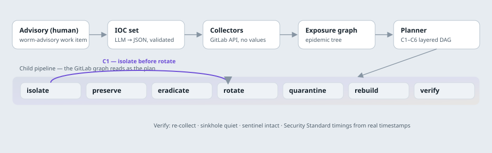

# Defuse: worm containment for GitLab CI

**When a Shai-Hulud-class worm hits, Defuse finds every CI job it ran in, every secret it could
read, every package it could republish and every AI-agent hook it planted — then contains it in
the one order that does not detonate it.**

Three numbers, all sourced:

- Only **23%** of Shai-Hulud 2.0 infections were on developer machines; most were CI runners and
  containers, and over 60% of leaked npm tokens were still valid a week later. ([Wiz, Dec 2025](https://wiz.io/blog/shai-hulud-2-0-aftermath-ongoing-supply-chain-attack))
- The Aug 2026 keyv worm moved between organizations every **2–7 minutes**, publishing with valid
  provenance through the victim's own release workflow. ([The Hacker News](https://thehackernews.com/2026/08/keyv-linked-npm-worm-poisons-hundreds.html) · [Microsoft](https://www.microsoft.com/en-us/security/blog/2026/08/04/chaindrop-supply-chain-compromise-anatomy-self-propagating-worm/))
- Revoking a stolen token can fire the attacker's revocation handler, and cutting registry and
  source access together wipes the host — so **there is one order that is safe**, and every public
  playbook is a manual checklist. ([SANS ISC, Aug 5 2026](https://isc.sans.edu/diary/33218) · [GitLab VR, Nov 24 2025](https://about.gitlab.com/blog/gitlab-discovers-widespread-npm-supply-chain-attack/))

**The insight:** containment is an ordering problem under adversarial triggers. Rotating
everything at once is the detonator. Defuse computes the exposure from GitLab data and executes a
plan whose order is *provably* safe — proven by Hypothesis property tests over 500 random
exposure graphs and by an adversary replay that detonates the naive baseline and leaves the
Defuse plan intact.

> _A 20-second GIF of the replay goes here once recorded against the live sandbox (see
> `docs/runbook.md`). The replay is reproducible now: `uv run defuse demo` then open the Replay
> view._

## How it works



An advisory becomes a schema-validated IOC set (the one human "intent in" moment). Deterministic
collectors read GitLab **metadata only** — never a secret value — and build an exposure graph:
the jobs that resolved an affected version, the runners and hosts they ran on, the secrets those
jobs could read (respecting protected refs and environment scopes), what those secrets can
publish, and — recursing on **provenance mismatches** to a fixpoint — the epidemic tree. The
planner turns the graph into a layered action DAG under the safety constraints below, compiles it
to a GitLab **dynamic child pipeline** (one job per action, `needs:` = plan order, stages = the
containment phases), executes it, and verifies the result. Full design: [`docs/architecture.md`](docs/architecture.md).

The planner and executor are deterministic code. The LLM only interprets, drafts and explains,
and every LLM output is validated against a schema before anything consumes it.

## The safety constraints (C1–C6)

Each is data in [`engine/defuse/plan/constraints.py`](engine/defuse/plan/constraints.py) with a
rationale and a source; an independent checker ([`plan/check.py`](engine/defuse/plan/check.py))
restates all six over the plan's layer indices, so a bug in plan construction cannot hide from
the check. The property tests assert no violation across 500 generated exposure graphs.

| ID | Rule | Why | Source |
| --- | --- | --- | --- |
| **C1** | Rotate/revoke a watched secret only after its host is isolated or the watcher stopped | revoking it fires the attacker's handler | [SANS ISC](https://isc.sans.edu/diary/33218) |
| **C2** | Snapshot a host before any eradication on it | preserve the forensic record | [SANS ISC](https://isc.sans.edu/diary/33218) |
| **C3** | On a live host, never cut registry-publish and source access in the same layer | dead-man's switch wipes the host | [GitLab VR](https://about.gitlab.com/blog/gitlab-discovers-widespread-npm-supply-chain-attack/) |
| **C4** | Rotate publish-capable secrets before all others | stop propagation first | [Microsoft](https://www.microsoft.com/en-us/security/blog/2026/08/04/chaindrop-supply-chain-compromise-anatomy-self-propagating-worm/) |
| **C5** | Remove planted hooks before re-enabling any agent that opened the repo | prevent re-infection | [The Hacker News](https://thehackernews.com/2026/08/keyv-linked-npm-worm-poisons-hundreds.html) |
| **C6** | Rebuild only after the exposed runner is paused | rebuild on a clean host | [GitLab VR](https://about.gitlab.com/blog/gitlab-discovers-widespread-npm-supply-chain-attack/) |

## Safety statement

The worm **simulator** ([`simulator/`](simulator/)) is inert anywhere but the sandbox: its
`preinstall` exits 0 and does nothing unless all three guards hold — `DEFUSE_SIM=1`, an
allow-listed instance host, and a project under the sandbox namespace. `node simulator/selftest.js`
proves it is a no-op off the sandbox and that it reads variable **names**, never values. The
simulator publishes only to the sandbox project's own registry, never npmjs.org. The engine
refuses any mutating GitLab call outside the configured sandbox namespaces, in the client layer.
Collectors never read or log a secret value — a contract test fails if a collector requests one.

## Lifecycle stages

| Stage | What Defuse does there |
| --- | --- |
| Plan | Advisory work item becomes a validated IOC set |
| Create | Hook-removal and policy MRs drafted by flows |
| Verify | Detector job; post-containment re-scan; product tests |
| Package | Rogue version quarantine; known-good pins; SBOM |
| Secure | Exposure graph; ordered rotation; SAST and scanning on itself |
| Release | Rebuild from clean runners; provenance verified before deploy |
| Configure | Runner isolation by network tag; variable scope tightening |
| Monitor | Sinkhole beacons; watcher and sentinel checks; Cloud Trace |
| Govern | Incident record; action ledger; tool-governance rules; Standard metrics |

## GitLab Duo Agent Platform

Four flows in [`.gitlab/duo/flows/`](.gitlab/duo/flows) (flow-registry v1 YAML):

- **advisory-intake** (trigger: Work item Created) — advisory → IOC JSON, committed via MR; on an
  ambiguous field it comments which field and stops — a calibrated refusal.
- **incident-commander** (trigger: Pipeline Failed) — a detector failure on a human's push opens
  an incident and starts the engine.
- **hook-sweeper** (headless) — one MR per repo removing the planted hooks, with a protected diff
  guard against touching anything off the provided list.
- **postmortem-policy** (headless) — the incident record as a work item, plus a policy MR
  (ignore-scripts, minimum release age, variable-scope tightening, lockfile enforcement).

Governance: delete-class tools denied for every flow; see [`docs/governance.md`](docs/governance.md).
_Catalog links are recorded here once the flows are created in the sandbox's AI Catalog._

## Google Cloud deployment

Terraform in [`infra/`](infra/) (GitLab-managed state): Artifact Registry; Cloud Run `engine`,
`web`, `sinkhole`; Cloud SQL Postgres; Secret Manager; a Workload Identity Pool + provider
trusting gitlab.com, pinned to the Defuse project path and protected refs (no static keys); the
persistent `e2-small` runner; and a deny-all-egress firewall rule for tag `quarantined`
(isolation = tag swap via API). _Live console URL recorded here after `terraform apply`._

## Run it locally

```
cd engine && uv sync && uv run defuse demo        # seed the scenario, print real metrics
uv run uvicorn defuse.api.app:create_app --factory --port 8000   # API + SSE, OpenAPI at /docs
cd ../web && DEFUSE_API=http://localhost:8000 npm install && npm run dev   # console at :5173
```

## Measured results — sandbox scenario

The engine ships a deterministic scenario (`uv run defuse demo`) that runs a real containment
against an in-memory GitLab backend, so these timings come from stored timestamps, not estimates.
Median of three runs (identical because the scenario clock is deterministic):

| Metric | Value |
| --- | --- |
| Time to detect | 6m 00s |
| Time to scope | 40s |
| **Time to containment** | **3m 07s** |
| **Time to verified remediation** | **3m 21s** |
| Actions executed | 15 (of 22 planned; 7 hand off to operator/flows) |
| LLM credits per incident | 3 |

Live three-run medians against a provisioned GitLab sandbox + GCP project are produced with
`docs/runbook.md` and recorded here; this build session had neither (`docs/decisions.md` D3).

## Quality

- `mypy --strict`, `ruff`, `svelte-check`, `eslint` all clean.
- Engine: 78 tests (unit, contract on recorded-shape fixtures, property). Property tests pass at
  **500 examples** per property. Coverage ≥90% on `model`, `graph`, `plan`, `execute/compiler`;
  ≥75% overall.
- Web: 5 Playwright e2e tests; Lighthouse performance 99–100, accessibility 95–96.
- GitHub Actions ([`.github/workflows/ci.yml`](.github/workflows/ci.yml)) mirrors the engine and
  web lint+test; `.gitlab-ci.yml` is the product pipeline of record.

## License

MIT — see [`LICENSE`](LICENSE).

Built for the GitLab Transcend "Life After Code" hackathon. Path A, Hands-off: an advisory goes
in, a contained and verified state comes out.
